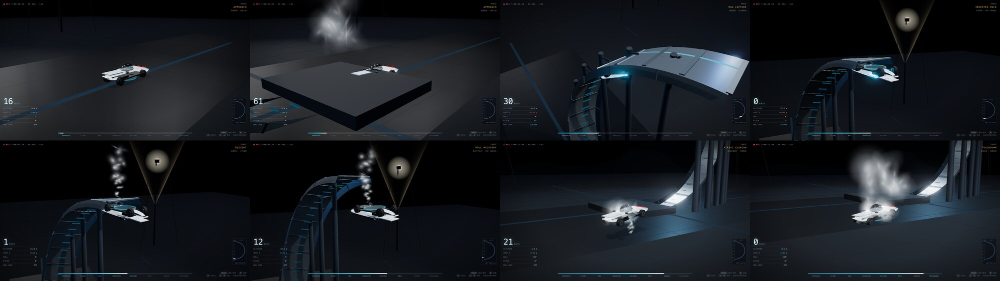

# Roadster @ C-Magnet Ramp

Tesla Roadster 在得州 SpaceX 测试场完成 C 形磁吸坡道倒挂测试的实时 3D 动画。

Three.js 负责场景与物理表现，SVG 负责遥测 HUD 与坡道侧视示意图。



## 运行

```bash
./fetch-deps.sh                       # 拉取 three.js 0.160.0 + postprocessing 依赖
npm run serve                         # http://127.0.0.1:8000
```

需要用 HTTP 访问（ES module + importmap 不能走 `file://`）。

## 测试

```bash
npm test              # 运动学单元测试（纯 node，43 项）
npm run test:browser  # 浏览器集成测试（CDP 驱动 Chrome，32 项）
npm run test:all      # 全部
```

| 测试 | 文件 | 项数 | 覆盖内容 |
|------|------|------|---------|
| 运动学 | `tests/kinematics.test.mjs` | 49 | 坡道几何、姿态基手性、助跑一致性、磁吸捕获精度、阶段连续性（边界左右两侧）、横滚、着陆、采样确定性、配置校验 |
| 几何 | `tests/geometry.test.mjs` | 19 | **轨道/车辆接触几何**：接触间隙、入坡过渡、倒挂捕获、悬停贴合、地面/着陆基准 |
| 粒子 | `tests/particles.test.mjs` | 23 | 纯逻辑不变量 + **真实实现源码验证**（位置独立性、槽位复用、生命周期、帧率无关） |
| 逐帧 | `tests/frame-check.mjs` | 7 | 逐帧检测：穿轨、悬空、瞬移、姿态镜像、朝向、穿地、速度连续性 |
| 浏览器 | `tests/browser.test.py` | 38 | CDP 真实驱动 Chrome：加载、粒子调试接口、播放/暂停/擦洗/重置/切机位/键盘、HUD 与运动学一致性、响应式、运行时错误 |

浏览器测试支持 `--chrome <路径>` 或环境变量 `CHROME_PATH`。
**浏览器不可用时以退出码 2 结束并明确报告"未执行"**，绝不报告为通过。

```bash
npm test              # 纯 node：49 + 19 + 23 + 7 = 98 项
npm run test:browser  # 浏览器：38 项
npm run test:all      # 全部
```

## 时间轴（13.96s）

| 阶段 | 时刻 | 关键量 |
|------|------|--------|
| APPROACH | 0.00–2.20s | 地面助跑 0→20 m/s，22m 距离，0.93g |
| CLIMB | 2.20–3.23s | 沿 C 形坡道冲刺，磁吸吸起（车身抬升 0.195m） |
| MAG CAPTURE | 3.23–6.07s | 等减速捕获，负 g 过载 −1.30→−0.47 |
| INVERTED HOLD | 6.07–7.13s | 车底吸附，180° 完全倒挂静止 1 秒 |
| DESCENT | 7.13–7.63s | 车底反推冷气缓降 |
| ROLL RECOVERY | 7.63–10.74s | 4 次侧向冷气脉冲驱动 0→180° 横滚回正 |
| AIRSAC CUSHION | 10.74–11.36s | 底部高压白雾缓冲，峰值 2.37g |
| TOUCHDOWN | 11.36–13.96s | 零速触地（v < 1e-9），避震压缩回弹 |

## 交互

| 键 | 作用 |
|----|------|
| `SPACE` | 播放 / 暂停 |
| `R` | 重置 |
| `C` | 切换机位 |
| `1`–`4` | 选定机位 |
| 拖动 | 时间轴擦洗 |

## 结构

```
outputs/
  index.html        主程序（场景 + 动画 + HUD）
  motion.js         运动学时间轴与采样（无渲染依赖）
  ramp-geometry.js  坡道几何与车辆姿态基（渲染层与运动学层共用）
  three.module.js   第三方依赖（fetch-deps.sh 生成）
  vendor/addons/    postprocessing 依赖（fetch-deps.sh 生成）
tests/
  kinematics.test.mjs  运动学单元测试（49）
  geometry.test.mjs    轨道/车辆接触几何测试（19）
  particles.test.mjs   粒子系统测试（23）
  frame-check.mjs      逐帧几何检测（7）
  browser.test.py      浏览器集成测试（38）
```

## 坐标系约定

这是本项目最容易出错的地方，定义在 `ramp-geometry.js` 并由测试断言。

**世界坐标系**：右手系，Y 向上。C 形环心在 `(0, R)`，参数 `a ∈ [0, π]`。

```
a = 0    → (0, 0, 0)     地面入口，切向 +X，车身正立
a = π/2  → (R, R, ·)     C 形右腰，切向 +Y，车身侧躺 90°
a = π    → (0, 2R, ·)    顶点，切向 −X，车身完全倒置 180°
```

**车辆模型局部轴**（由 `buildCar()` 的几何决定）：

| 局部轴 | 含义 | 依据 |
|--------|------|------|
| +X | 车长轴，**车尾**方向 | 剖面 x ∈ [−2.05, 2.16]，车头在 −X |
| +Y | 车顶方向 | 座舱玻璃罩在 +Y |
| +Z | 车宽轴（车轮轴） | 车轮 `rotation.x = π/2` |

**姿态基构造**：`makeCarBasis(fwd, up)` → `makeBasis(xAxis, up, zAxis)`，
其中 `xAxis = −fwd`（模型 +X 指向车尾）、`zAxis = up × fwd`。
校验：`det(xAxis, up, zAxis) = +1`（纯旋转），三向量两两正交且归一。

> `zAxis` 若取 `fwd × up` 会得到 det = −1 的**镜像矩阵**，
> three.js 会渲染出翻转的模型 —— 这是本项目修过的一个隐蔽缺陷。

**轨道与车辆的接触几何**（这是最容易出错的地方）

| 量 | 含义 |
|----|------|
| `rampPoint(a)` | 轨道**车行面** —— 车辆实际压住的那张曲面。全系统唯一的位置基准 |
| `rampUp(a)` | 指向环心的法向 = 车身顶面方向 = 车身"上"方向 |
| `rampSurface(a, T)` | 轨道**背面** = `rampPoint − rampUp·T`，实体向背离环心一侧延伸 |
| `CAR.rideHeight` | 0.58 —— 车身中心离地（轮胎接地），仅地面/着陆阶段使用 |
| `CAR.magContact` | 0.385 —— 车身中心到磁吸盘贴合面，坡道磁吸阶段使用 |

于是：

```
车身中心(磁吸) = rampPoint(a) + rampUp(a)·magContact
磁吸接触面     = 车身中心 − rampUp(a)·magContact = rampPoint(a)   ✓ 零间隙
```

> ⚠ 早前版本渲染层用 `rampSurface(a, 0.55)` 当车行面，
> 而运动学层的接触面落在 `rampPoint` —— 两者恒有 **0.55m 间隙**。
> `tests/geometry.test.mjs` 现在对 a=0/π/2/π 三个位置断言接触间隙为 0。

两者相差 0.195m：磁吸时轮胎悬空（车被磁力吸住，不是压在轨道上）。
入坡时用 `lift` 因子在 `a ∈ [0, 0.55]` 区间连续过渡，接触间隙从 +0.195m 单调收敛到 0。

## 关键实现

**磁吸捕获** — 用解析速度剖面而非离散积分：

```
弧长域等减速  s(τ) = s₀ + v₀τ − ½cτ²,  v(τ) = v₀ − cτ
c = v₀²/(2·d_cap)  ⇒  停止时间 τ_cap = v₀/c
每步由弧长反解参数 a（二分）
```

这样停车位置由解析式保证，与步长 `dt` 无关。
（早期版本用参数域半隐式欧拉，离散误差使车停在 179.877° 而非 180°。）

**气垫缓冲** — 用**解析解**而非离散积分，天然零速触地。

物理模型：按剩余高度反解所需减速度 `a = v²/(2h)`（恰好能在剩余高度内停住）。
分离变量 `dv/dh = v/(2h)` 得：

```
v(h) = v₀·√(h/h₀)
h(t) = (√h₀ − C·t/2)²,   C = v₀/√h₀
```

`h→0` 时 `v→0` 严格成立。

> 早前版本对反解方程做欧拉离散积分，必然产生两种缺陷：
> ① `max(0.12, h)` 地板给减速度设上限 → 触地残余速度 **1.077 m/s**
> ② 即使去掉地板，离散步进仍过冲 → 触地时位置已低于地面而速度被强行置 0 → 速度突变
>
> 解析解从根上消除了"离散化 vs 连续反解"的矛盾。
> 修复后触地速度 **0.000000000000 m/s**，阶段边界速度跳变 0.026 m/s。

**反推喷口** — 推力随速度上升，净下压加速度随之衰减：

```js
net = A0 * (1 - fall * min(vy / vRef, 1))
```

**粒子系统** — 用 `InstancedMesh` billboard 而非 `THREE.Points`：
SwiftShader 的点精灵尺寸上限会把大尺寸粒子整批丢弃。
每个粒子持有独立位置（`px/py/pz`），不使用共享向量。
透明度由颜色亮度承载（`instanceColor` 在 three 中无 alpha 通道），死亡粒子缩放为 0。

## 已知限制

- 物理为**艺术化近似**，非真实工程仿真：磁吸力、气垫反解、脉冲横滚都是为叙事设计的模型。
- 坡道扭转 `z = ½ka²` 使切向带 z 分量，因此"切向朝 ±X"只在 XY 平面意义上成立。
- 车辆沿环**内侧**行驶，车位于轨道与环心之间；因此从某些机位看，坡道板会遮挡车身。
  机位已按"相机必须在 up 侧"的原则配置，但极端角度仍可能局部遮挡。
- 无音频。
- 移动端竖屏可用但未做专门构图优化（相机会按宽高比自动拉远）。

## License

MIT
